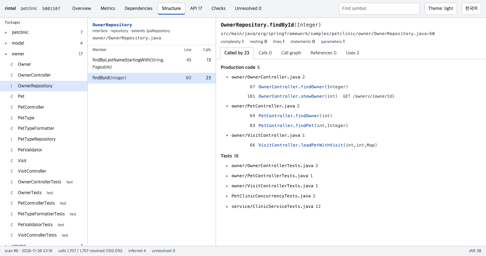
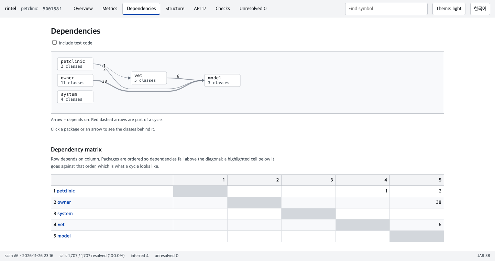

<h1 align="center">rintel</h1>

<p align="center">
  <b>Repository Intelligence.</b> 누가 무엇을 호출하는지, 변경이 무엇을 깨는지, 무엇을 고쳐야 하는지를<br>
  정적 분석으로 답하고, 모든 답에 근거를 붙입니다.
</p>

<p align="center">
  <a href="https://github.com/spro1/rintel/actions/workflows/ci.yml"></a>
  <a href="LICENSE"></a>
  
  
</p>

<p align="center"><a href="README.md">English</a> · 한국어</p>



rintel은 저장소를 한 번 읽어 로컬 인덱스를 만들고, 텍스트 검색으로는 틀리기 쉬운 질문에 답합니다. 오버로드,
인터페이스, 의존성 주입을 해석하고 운영 코드와 테스트를 구분합니다. 터미널, 코딩 에이전트, HTML 보고서 한 장으로
쓸 수 있습니다.

```
$ rintel callers OwnerRepository.findById
OwnerRepository.findById(Integer)                    owner/OwnerRepository.java:60
  ← OwnerController.findOwner(Integer)               owner/OwnerController.java:67
  ← OwnerController.showOwner(int)                   owner/OwnerController.java:181
  ← PetController.findOwner(int)                     owner/PetController.java:69
  ...
```

## 목차

- [왜 rintel인가](#왜-rintel인가)
- [설치](#설치)
- [빠른 시작](#빠른-시작)
- [무엇을 물어볼 수 있나](#무엇을-물어볼-수-있나)
- [보안·품질 점검](#보안품질-점검)
- [HTML 보고서](#html-보고서)
- [코딩 에이전트에서 쓰기](#코딩-에이전트에서-쓰기)
- [지원 언어](#지원-언어)
- [설정](#설정)
- [결과 읽는 법](#결과-읽는-법)
- [분석 범위와 한계](#분석-범위와-한계)
- [로드맵](#로드맵)
- [기여](#기여)

## 왜 rintel인가

- **로컬에서만 돌고, 아무것도 실행하지 않습니다.** 소스는 PC 밖으로 나가지 않고, 저장소의 코드나 빌드 도구,
  어노테이션 프로세서, `node_modules`의 코드를 실행하지 않습니다. 신뢰할 수 없는 코드에 돌려도 안전합니다.
  네트워크를 쓰는 기능은 `check --vulns` 하나뿐이고, 직접 켜야 동작합니다.
- **모든 답에 근거가 붙습니다.** 코드에서 읽은 사실에는 표시가 없습니다. 추정에는 사용한 규칙 이름이 붙습니다.
  해석하지 못한 지점은 사유와 함께 *미해석*으로 기록하므로, "없음"과 "못 봄"을 구분할 수 있습니다.
- **발견 항목마다 수정 방법이 있습니다.** 보안·품질 규칙은 무엇을 바꿔야 하는지를 터미널, JSON, SARIF, 에이전트
  응답에 함께 알려 줍니다.
- **인덱스 하나, 쓰는 방법 셋.** CLI, 코딩 에이전트용 [MCP](https://modelcontextprotocol.io) 서버와 스킬, 파일
  하나짜리 HTML 보고서.

## 설치

```sh
go install github.com/spro1/rintel/cmd/rintel@latest
```

`rintel`이 `$(go env GOPATH)/bin`에 설치됩니다. 이 경로가 `PATH`에 있어야 합니다.
소스에서 빌드하려면(Go 1.27.4 이상) `git clone https://github.com/spro1/rintel && cd rintel && make build`를
실행합니다.

## 빠른 시작

```sh
cd <분석할 저장소>
rintel doctor          # 이 PC에서 분석 가능한 언어 점검
rintel stats           # 스캔한 뒤 해석률을 보여 줌
rintel report --open   # HTML 보고서
```

스캔 명령을 따로 실행할 필요가 없습니다. 모든 명령이 파일이 바뀌었으면 인덱스를 먼저 갱신합니다. 인덱스는
`.ri/cache/`에 저장되고, rintel이 스스로 git에서 제외합니다.

## 무엇을 물어볼 수 있나

| 질문 | 명령 |
|---|---|
| 누가 이걸 호출하나? | `rintel callers UserService.createUser --depth 2` |
| 이건 무엇을 호출하나? | `rintel callees UserService.createUser` |
| 이 타입이나 필드는 어디서 쓰이나? | `rintel refs UserDto` |
| 정확한 이름이 뭐였지? | `rintel find User` |
| 내 변경이 어디에 영향을 주나? 어떤 테스트를 돌려야 하나? | `rintel impact --base origin/main` |
| REST 엔드포인트는 뭐가 있나? | `rintel api --prefix /users` |
| 보안이나 구조에 문제가 있나? | `rintel check` |
| 복잡한 곳은 어디인가? | `rintel metrics method --top 20` |
| 패키지들은 서로 어떻게 의존하나? | `rintel deps` |
| 분석이 얼마나 볼 수 있었나? | `rintel stats` |

<details>
<summary>전체 명령과 옵션</summary>

| 명령 | 하는 일 |
|---|---|
| `rintel callers <심볼>` | 호출하는 곳을 트리로 (`--depth 1..3`) |
| `rintel callees <심볼>` | 호출되는 대상을 소스 순서대로 |
| `rintel refs <심볼>` | 참조하는 모든 곳: 호출, 타입·필드 사용, 주입, 오버라이드 |
| `rintel find <이름>` | 클래스·메서드·필드 검색 |
| `rintel api` | REST 엔드포인트와 핸들러 (`--prefix`) |
| `rintel metrics [class\|method\|package\|file]` | 복잡도·크기·결합도·응집도 (`--top N`, `--tests`) |
| `rintel deps` | 패키지 의존과 순환 (`--format dot\|mermaid`로 다이어그램) |
| `rintel check` | 보안·품질 발견 항목. 경고가 있으면 종료 코드 1 |
| `rintel impact` | 변경의 영향 (`--base REF`, `--depth 1..6`, `--format md`) |
| `rintel stats` | 해석률과 미해석 사유 |
| `rintel report` | HTML 보고서 (`--open`, `--out 파일`, `--source`) |
| `rintel scan` | 인덱스 수동 갱신 (`--full`은 처음부터 다시) |
| `rintel mcp` | MCP 서버 (stdio) |
| `rintel doctor` | 이 PC에서 분석 가능한 언어 점검 |

- **심볼**은 rintel이 출력하는 형태 그대로 씁니다: `UserService.createUser`,
  `"UserService.createUser(String)"`, `web.Server.handle`(Go: 패키지), `service.UserService.create`
  (TypeScript·Python: 파일), 전체 ID. 이름이 틀리면 가까운 이름을 제안합니다.
- **출력 형식**: 모든 명령에 `--format json`, 지표에는 `--format csv`. JSON과 MCP 응답은 같은 스키마입니다.
- **언어**: `--lang en|ko` 또는 `RINTEL_LANG`, 없으면 시스템 로캘을 따릅니다.
- **그 밖의 옵션**: `-C <디렉터리>`로 저장소 루트 지정, `--no-scan`으로 기존 인덱스만 사용.
- **종료 코드**: 0 정상, 1 심볼 없음 또는 점검 실패, 2 사용법 오류, 3 분석 오류.

</details>

## 보안·품질 점검

`rintel check`는 규칙 22개를 보고, 걸린 규칙마다 수정 방법을 함께 출력합니다.

```sh
rintel check                                   # 경고가 하나라도 있으면 빌드 실패
rintel check --category security               # 한쪽만: security 또는 quality
rintel check --changed-since origin/main       # 이 브랜치가 건드린 파일만
rintel check --format sarif > rintel.sarif     # 코드 스캐닝 대시보드용
rintel impact --base origin/main --format md   # PR 코멘트용
```

**보안 규칙**

| 규칙 | 찾는 것 | 등급 | CWE |
|---|---|---|---|
| `hardcoded-secret` | 소스와 git이 추적하는 설정 파일에 적힌 비밀번호·키·토큰 | 경고 | 798 |
| `sql-concatenation` | 값을 이어 붙여 만든 SQL | 경고 | 89 |
| `tls-verification-disabled` | 인증서·호스트 이름 검증 해제 | 경고 | 295 |
| `unsafe-deserialization` | 입력에 담긴 코드를 실행할 수 있는 역직렬화 | 경고 | 502 |
| `dynamic-code` | `eval`, `exec`, `new Function` | 경고 | 95 |
| `weak-crypto` | MD5, SHA-1, DES, RC4, ECB | 참고 | 327 |
| `command-execution` | 외부 명령 실행 | 참고 | 78 |
| `html-injection` | `innerHTML`, `v-html`, `template.HTML` | 참고 | 79 |

**경고**는 빌드를 실패시킵니다. **참고**는 검토할 곳을 알려 줄 뿐 실패시키지 않습니다.

> [!NOTE]
> 보안 규칙은 소스 텍스트를 문장 단위로 대조합니다. 코드를 바꾸기 전에 실제 문제인지 확인하세요. 고정된 조각과
> 바인딩 파라미터로 조립한 SQL도 인젝션이 가능한 SQL과 똑같이 보고됩니다. 결과에는 해당 줄의 내용을 싣지 않으므로
> 보고서가 비밀값을 퍼뜨리지 않습니다.

<details>
<summary>품질 규칙</summary>

**경고** 10개: 복잡한·긴·중첩이 깊은·매개변수가 많은 메서드, 큰·결합도가 높은·응집도가 낮은 클래스, 패키지·클래스
순환 의존, 아래 계층이 위 계층에 의존하는 경우.

**참고** 4개: 서비스 계층을 건너뛴 컨트롤러, 참조 없는 코드·테스트에서만 쓰는 코드·테스트가 닿지 않는 클래스 후보.
참고는 정적 관계만으로 찾으므로 프레임워크·리플렉션·템플릿 호출이 있으면 틀릴 수 있습니다.

기준값은 [`.ri/config.json`](#설정)에서 바꿉니다.

</details>

<details>
<summary>취약한 의존성: <code>rintel check --vulns</code> (기본은 꺼짐, 네트워크 사용)</summary>

고정된 의존성 버전을 [osv.dev](https://osv.dev)에서 조회해, 알려진 취약점과 수정된 버전을 알려 줍니다.

- **보내는 것**: 패키지 이름과 버전뿐입니다. 보내기 전에 그 사실을 출력합니다. `GOPRIVATE`에 해당하는 Go 모듈과
  사설 레지스트리의 npm 패키지는 보내지 않습니다.
- **네트워크가 없을 때**: 다른 점검은 그대로 진행하고, 의존성 검사를 하지 못했다고 알린 뒤 종료 코드 3으로
  끝납니다. 검사하지 못한 빌드가 CI를 통과하지 않게 하기 위해서입니다.
- **읽는 파일**: `go.mod`, `package-lock.json`, `requirements*.txt`, `poetry.lock`, `uv.lock`, Maven·Gradle 빌드
  파일에 적힌 아티팩트.
- **보지 않는 것**: yarn·pnpm 잠금 파일, 버전 범위, Java의 전이 의존성.
- 걸렸다는 것은 그 버전이 영향을 받는다는 뜻이지, 취약한 코드가 실제로 실행된다는 뜻은 아닙니다.

</details>

## HTML 보고서

`rintel report --open`은 정적 HTML 파일 하나를 만듭니다. 외부 리소스와 외부 JavaScript를 쓰지 않아 오프라인에서
열리고, 파일 그대로 전달할 수 있습니다. 화면 안에서 영어/한국어를 바꿀 수 있습니다.



| 탭 | 보여 주는 것 |
|---|---|
| 개요 | 패키지별 크기·경고·해석률, 패키지 그래프, 가장 많이 의존받는 클래스 |
| 지표 | 트리맵(면적 = 줄 수, 색 = 최대 복잡도)과 정렬 가능한 표 |
| 의존성 | 패키지 그래프, 의존성 매트릭스, 패키지 결합도 |
| 구조 | 패키지 트리, 멤버, 심볼별 호출자·호출 그래프·상속 |
| API | 엔드포인트와 핸들러 |
| 점검 | `rintel check`와 같은 발견 항목, 규칙별 수정 방법 |
| 미해석 | 분석이 해석하지 못한 모든 지점 |

`--source`를 주면 소스 코드도 함께 담아 소스 탭이 생깁니다. 보고서에 코드 본문이 들어가므로 기본은 꺼져 있습니다.
심볼 이름과 파일 경로는 항상 들어가므로 외부에 공유하기 전에 확인하세요.

## 코딩 에이전트에서 쓰기

rintel은 **스킬**(어떤 질문에 어떤 명령을 쓰고 결과를 어떻게 다룰지)과 **MCP 서버**(같은 데이터를 도구 호출로
제공)를 함께 제공합니다. 둘 다 `rintel` 실행 파일이 `PATH`에 있어야 합니다.

**Claude Code**

```
/plugin install rintel --marketplace spro1/rintel
```

| 스킬 | 쓰는 때 |
|---|---|
| `rintel` | 누가 호출하나, 어디서 쓰이나, 지워도 되나 |
| `/rintel:impact` | 변경이 미치는 범위, 돌릴 테스트, 새 경고 |
| `/rintel:security` | 발견 항목을 코드와 대조해 판정하는 보안 검토 |

플러그인은 MCP 서버도 등록하고, 세션을 시작할 때 실행 파일이 없으면 알려 줍니다.
Claude Code 2.1.275 미만에서는 `/plugin marketplace add spro1/rintel`을 실행한 뒤
`/plugin install rintel@rintel`을 실행합니다.

**MCP만 쓰거나 다른 에이전트를 쓸 때**

```sh
claude mcp add rintel -- rintel mcp
```

서버는 자신이 실행된 저장소를 분석하므로 한 번 등록하면 모든 프로젝트에서 씁니다(`-C <디렉터리>`로 고정 가능).
스킬은 [`skills/`](skills/) 아래의 Markdown 파일이고 명령어만 사용하므로 어떤 에이전트에도 줄 수 있습니다.

<details>
<summary>MCP 도구</summary>

`get_overview`, `search_symbols`, `get_symbol`, `get_neighbors`, `get_api_spec`, `get_metrics`, `get_dependencies`,
`get_checks`, `analyze_impact`, `scan_repository`.

모든 응답에 `scan` 블록이 있습니다. `scan.stale`이 true이면 스캔 이후 작업 트리가 바뀐 것이고,
`scan_repository`로 갱신합니다. 응답에는 식별자와 위치만 있고 소스 본문은 없습니다.

</details>

## 지원 언어

| 언어 | 필요한 것 | 라이브러리를 읽는 곳 |
|---|---|---|
| Java (Spring, Lombok) | JDK 17+ (`javac` 포함) | 로컬 Gradle·Maven 캐시 (자동으로 찾음) |
| Go | Go 툴체인과 `go.mod` | 모듈 캐시 (`GOMODCACHE`) |
| TypeScript, JavaScript, Vue | Node.js 18+ | 저장소의 `node_modules`. 컴파일러는 내장 |
| Python | `python3` 3.8+ | 없음. 외부 패키지 import는 이름으로 기록 |

한 저장소에 여러 언어가 섞여 있어도 됩니다. 툴체인이 없는 언어는 경고와 함께 건너뜁니다.

> [!TIP]
> rintel은 아무것도 내려받지 않습니다. 라이브러리가 PC에 없으면 그 타입을 거치는 호출은 미해석으로 남고,
> `rintel stats`가 없는 패키지 이름을 알려 줍니다. **프로젝트를 한 번 빌드한 뒤** 다시 스캔하세요.

| 저장소 | 언어 | 파일 | 호출 해석률 | 전체 스캔 |
|---|---|---|---|---|
| spring-petclinic | Java | 50 | 100% (첫 빌드 전 99.5%) | 0.7초 |
| spring-boot-realworld-example-app | Java | 144 | 100% (첫 빌드 전 76.4%) | 1.0초 |
| k8s.io/client-go | Go | 2,453 | 98.7% | 약 4초, 620MB |

client-go 기준으로 변경 없는 재스캔은 0.3초, 파일 하나를 고친 뒤에는 약 1.5초입니다.

## 설정

선택 사항이며 `.ri/config.json`에 둡니다. 모르는 키는 무시하지 않고 오류로 처리합니다.

```json
{
  "exclude": ["**/*.pb.go", "legacy/**"],
  "thresholds": {
    "cc": 15, "method_loc": 80, "nesting": 4, "params": 5,
    "wmc": 50, "class_loc": 500, "cbo": 14, "lcom": 1
  },
  "disable": ["untested-class"]
}
```

`exclude`는 분석에서 뺄 경로, `thresholds`는 품질 규칙의 기준값, `disable`은 끌 규칙의 ID입니다.

## 결과 읽는 법

| 근거 | 의미 | 표시 |
|---|---|---|
| declared (선언) | 코드에 적혀 있음: 어노테이션, `import`, 라우트 등록 | 표시 없음 |
| resolved (확정) | 타입 해석으로 확정: `repo.save()` → `CrudRepository.save` | 표시 없음 |
| heuristic (추정) | 이름 있는 규칙으로 추정: 주입 후보가 여럿이거나, 어느 구현체든 대상일 수 있음 | `~추정: 규칙이름` |

분석이 보지 못한 곳은 사유와 함께 미해석 참조로 남깁니다: `missing-classpath`, `missing-module`, `missing-type`,
`dynamic-call`, `reflection`. 비율은 `rintel stats`에서 볼 수 있습니다.

Java, Go, TypeScript는 각 언어의 타입 검사기로 해석합니다. Python에는 정적 타입이 없어서, 이름이 `def`·`class`·
`import`로 묶여 있거나 수신 객체의 클래스를 타입 힌트·생성자 호출·`self`로 알 수 있을 때만 *확정*입니다. 그 밖에는
그 이름의 메서드를 가진 클래스가 3개 이하면 *추정*, 아니면 미해석입니다.

<details>
<summary>지표 정의</summary>

| 지표 | 정의 |
|---|---|
| CC | 순환 복잡도: 1 + `if`, 반복문, `case`, `catch`, `?:`, `&&`, `\|\|`의 수 |
| 중첩 | 제어 구조가 가장 깊게 겹친 단계 |
| WMC | 클래스의 메서드 CC 합 |
| CBO | 이 클래스가 참조하거나 이 클래스를 참조하는 저장소 내 다른 클래스 수 |
| RFC | 클래스의 메서드 수 + 그 메서드들이 호출하는 서로 다른 메서드 수 |
| DIT / NOC | 상속 깊이 / 직접 하위 클래스·구현체 수 |
| LCOM | LCOM4: 필드를 공유하지도 서로 호출하지도 않는 메서드 묶음 수(접근자 제외). 1이면 응집 |
| Ca / Ce | 패키지 밖에서 의존해 오는 클래스 수 / 패키지가 의존하는 바깥 클래스 수 |
| 불안정도 | Ce / (Ca + Ce) |
| 추상도, 거리 | (인터페이스 + 추상 클래스) / 클래스, 그리고 \|추상도 + 불안정도 − 1\| |

도구마다 정의가 다릅니다(CBO에 라이브러리를 세는지, 한 줄의 기준 등). 다른 도구의 수치와 비교할 때 감안하세요.
Lombok과 컴파일러가 만든 멤버는 제외합니다. Java 밖에서 "클래스"는 이름 있는 타입 또는 한 파일의 최상위 선언
묶음이고, "패키지"는 Go 패키지 또는 디렉터리입니다.

</details>

## 분석 범위와 한계

<details>
<summary>Java</summary>

- 지원: 호출, 타입·필드 사용, 상속, 오버라이드. Lombok 접근자·생성자·빌더·로거(프로세서를 실행하지 않고 멤버를
  메모리에 추가). Spring 빈과 주입(`@Autowired`, 생성자, `@Qualifier`, `@Primary`, `@Bean`), MVC 엔드포인트.
- 아직 없음: MyBatis XML, JPA 매핑, 커스텀 스테레오타입 어노테이션, `@Singular`, `@With`, `@Delegate`.
- 라이브러리 버전은 빌드가 선언한 것을 따릅니다: `build.gradle`·`pom.xml`의 좌표, Gradle 버전 카탈로그와 변수,
  Maven 속성, Spring Boot 버전이 관리하는 것. 버전 범위는 따르지 않고, 선언이 없는 라이브러리는 캐시의 최신
  버전을 씁니다.
- 정확한 버전이 필요하면 빌드 도구의 클래스패스를 `.ri/classpath`에 적습니다
  (`mvn dependency:build-classpath -Dmdep.outputFile=.ri/classpath` 출력을 그대로 쓸 수 있습니다).

</details>

<details>
<summary>Go</summary>

- 지원: 호출, 타입·필드 사용, 인터페이스 구현, 임베딩. `net/http`, gin, echo, chi, gorilla/mux, fiber,
  httprouter 라우트.
- 인터페이스 메서드 호출은 인터페이스 메서드로 연결하고(확정), 구현체가 5개 이하이면 구현 메서드로도
  연결합니다(추정).
- 함수 값을 통한 호출은 `dynamic-call`입니다. 라우트 그룹의 경로 접두어는 합쳐지지 않습니다.
- `vendor/`, `testdata/`는 건너뛰고, cgo 전용 파일은 읽지 않습니다.

</details>

<details>
<summary>TypeScript, JavaScript, Vue</summary>

- 지원: 호출(JSX 컴포넌트 사용 포함), 타입·멤버 사용, `extends`·`implements`, 오버라이드. Hono, Express,
  Fastify, Koa 라우터의 라우트.
- 프로젝트가 쓰는 버전과 무관하게 내장 TypeScript 5.9.3 컴파일러로 분석합니다. 이 컴파일러가 모르는
  `tsconfig.json` 옵션은 무시합니다.
- `.vue` 파일은 `<script>` 블록만 분석합니다. 템플릿에서 참조하는 것은 보이지 않습니다.
- 콜백 매개변수와 `any`를 통한 호출은 `dynamic-call`입니다.

</details>

<details>
<summary>Python</summary>

- 지원: 함수, 클래스, 메서드, `self`에 대입한 필드, 상속, 오버라이드. FastAPI·Flask 라우트 데코레이터(모양으로
  인식하므로 추정으로 표시).
- 다루지 않음: 함수를 바꿔치기하는 데코레이터, 메타클래스, `getattr`.

</details>

<details>
<summary>그 밖의 것</summary>

- **생성된 코드**(`build/generated*`, `target/generated-*`, `generated/`, `*.pb.go`, `*_gen.go`, `*.gen.ts`,
  `*_pb2.py`)는 호출 해석을 위해 분석하지만, 테스트 코드처럼 지표·점검·그래프에서는 기본으로 뺍니다(`--tests`
  또는 보고서의 체크박스로 포함).
- **다른 언어**(Kotlin, C#, Rust 등)는 파일 수를 세어 "분석하지 않은 언어"로 표시합니다.
- **후보 목록**("참조 없는 메서드", "테스트가 닿지 않는 클래스")은 정적 관계만으로 계산합니다.
  프레임워크·리플렉션·템플릿 호출은 보이지 않으므로 출발점으로만 쓰세요.
- **플랫폼**: macOS에서 개발·검증했고 CI는 Linux에서 돕니다. Windows는 검증하지 않았습니다.

</details>

## 로드맵

- [ ] 배포용 실행 파일 (Go 없이 설치)
- [ ] Codex용 플러그인 (지금은 `codex mcp add rintel -- rintel mcp`로 MCP 서버를 쓰고, 스킬 파일은 직접 복사)
- [ ] `--vulns`: Java 전이 의존성, yarn·pnpm 잠금 파일
- [ ] MyBatis 매퍼 XML과 JPA 엔티티
- [ ] Windows 검증
- [ ] 언어 추가 (Kotlin부터)

## 기여

이슈와 풀 리퀘스트를 환영합니다. 방법은 [CONTRIBUTING.md](CONTRIBUTING.md)를, 취약점 제보는
[SECURITY.md](SECURITY.md)를 참고하세요.

```sh
make test     # go vet + go test
make vuln     # govulncheck. "No vulnerabilities found." 이어야 함
```

각 언어의 테스트는 그 언어의 툴체인이 있어야 돌고, 없으면 건너뜁니다. 테스트의 핵심 보증은 "모든 언어에서, 어떤
수정 뒤에도 증분 스캔 결과가 전체 스캔 결과와 같다"입니다.

**의존성 정책.** 알려진 취약점이 없는 버전만 씁니다. 직접 의존하는 Go 모듈은 둘(`modernc.org/sqlite`, 공식 MCP Go SDK)이고, 이들이 끌어오는 것까지 빌드에 들어가는 모듈은 18개입니다(모두 MIT 또는 BSD 라이선스).
컴파일러 하나(TypeScript 5.9.3, Apache-2.0, 수정 없음. 출처는
[cmd/rintel/adapter/README.md](cmd/rintel/adapter/README.md))를 내장합니다. Java·Python 어댑터와 보고서는 외부
라이브러리를 쓰지 않습니다. 의도적으로 단순하게 처리한 곳에는 교체 시점을 적은 `shortcut:` 주석이 있습니다.

## 라이선스

Apache-2.0. [LICENSE](LICENSE)와 [NOTICE](NOTICE)를 참고하세요.
