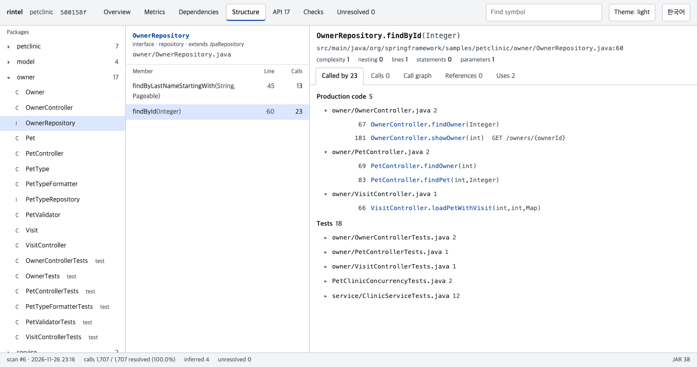
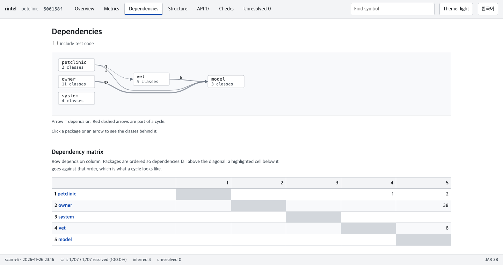

# rintel — Repository Intelligence

[](https://github.com/spro1/rintel/actions/workflows/ci.yml)
[](LICENSE)

English · [한국어](README.ko.md)

rintel is a local static-analysis tool that answers three questions about a code base:

- **Who calls and references this?** Callers, callees and references for any method, class or field.
- **How is it structured?** Package dependencies, cycles, layers, HTTP endpoints, and size, complexity and coupling metrics.
- **What does my change affect?** From a git diff to the callers, endpoints and tests that reach it.

It reads **Java, Go, TypeScript / JavaScript (React, Vue) and Python**, and it tells you how sure it is about each answer.



## Why another one

- **Nothing leaves the machine and nothing from the repository runs.** No network access, no build tool, no annotation processor, no `go list`, nothing from `node_modules`, no Python import. It is safe to point at code you do not trust.
- **Every relation carries its evidence.** A fact read from the code is unmarked. An inference names the rule that produced it. A place analysis could not see through is recorded as *unresolved* with a reason, so an empty answer can be told apart from a blind spot.
- **One index, three ways in:** a CLI, an [MCP](https://modelcontextprotocol.io) server for coding agents, and a self-contained HTML report.

## Quick start

```sh
go install github.com/spro1/rintel/cmd/rintel@latest

cd your-repository
rintel doctor        # which languages can be analyzed on this machine
rintel stats         # scans, then says how much was resolved
rintel report --open # the HTML report
```

Building from source needs Go 1.27.4 or newer: `git clone https://github.com/spro1/rintel && cd rintel && make build`.

```
$ rintel callers OwnerRepository.findById          # spring-petclinic
OwnerRepository.findById(Integer)                    owner/OwnerRepository.java:60
  ← OwnerController.findOwner(Integer)               owner/OwnerController.java:67
  ← OwnerController.showOwner(int)                   owner/OwnerController.java:181
  ← PetController.findOwner(int)                     owner/PetController.java:69
  ...

$ rintel metrics class --top 3
class            loc  methods  fields  wmc  max_cc  avg_cc  cbo  rfc  dit  noc  lcom  fan_in  fan_out
PetController    161       12       3   31       9    2.58    9   46    0    0     4       1        8
Owner            141       13       4   27       7    2.08   16   32    3    0     2      11        5
OwnerController  141       12       2   22       7    1.83    5   42    0    0     2       1        4
```

## What each language needs

| Language | Needs | Dependencies come from |
|---|---|---|
| Java | a JDK 17+ with `javac` | jars in the local Gradle/Maven caches (`~/.gradle`, `~/.m2`), found automatically; or list them in `.ri/classpath` |
| Go | the Go toolchain and a `go.mod` | module sources in the module cache (`GOMODCACHE`) |
| TypeScript, JavaScript, Vue | Node.js 18+ | type declarations in the repository's `node_modules`; the compiler itself is bundled (TypeScript 5.9.3) |
| Python | `python3` 3.8+ | nothing: imports of third-party packages are recorded by name |

A repository may mix languages. A language whose toolchain is missing is skipped with a warning, and the rest is still analyzed.

rintel downloads nothing. A library that is not on the machine becomes `missing-classpath` / `missing-module` unresolved references, and `rintel stats` names the missing packages. **Build the project once** (so its build tool fetches the dependencies) and scan again: on `spring-boot-realworld-example-app` that took call resolution from 76% to 100%.

## Commands

Run them anywhere inside a repository. Queries refresh the index first when files changed (`--no-scan` turns that off). The index lives in `.ri/cache/`, which rintel git-ignores by itself, so `git add -A` never picks it up.

```sh
rintel callers UserService.createUser --depth 2   # who calls it, as a tree
rintel callees UserService.createUser             # what it calls, in source order
rintel refs UserDto                               # everything that references it
rintel find User                                  # search symbols
rintel api                                        # HTTP endpoints
rintel metrics [class|method|package|file]        # complexity, size, coupling, cohesion
rintel deps                                       # package dependencies and cycles (--format dot|mermaid)
rintel check                                      # quality gate: exits 1 on warnings (--format sarif)
rintel impact --base origin/main                  # what a change affects: callers, endpoints, tests to run
rintel stats                                      # how much was resolved, and what was not
rintel report --open                              # the HTML report
rintel scan [--full]                              # refresh the index (queries do this themselves)
rintel mcp                                        # MCP server on stdio
```

- A symbol can be written the way rintel prints it: `UserService.createUser`, `"UserService.createUser(String)"`, `web.Server.handle` (Go: package), `service.UserService.create` (TypeScript, Python: file), or a full ID. A typo gets a suggestion.
- `--format json` everywhere; `--format csv` for metrics. JSON output and MCP responses share one schema.
- Output language: `--lang en|ko`, or `RINTEL_LANG`, else the system locale.
- Exit codes: 0 ok, 1 symbol not found or check failed, 2 usage error, 3 analysis error.

### In CI

`rintel check` runs 14 rules. Ten are **warnings** and fail the build: complex, long, deeply nested or many-parameter methods; large, highly coupled or low-cohesion classes; package and class dependency cycles; upward layer dependencies. Four are **notes** and do not: controllers that skip the service layer, and candidates for unreferenced, test-only and untested code. Notes come from static relations only, so a framework, reflection or template call can make them wrong.

```sh
rintel check                                  # exit 1 if there is any warning
rintel check --changed-since origin/main      # only findings in files this branch touched (for existing code bases)
rintel check --fail-on never --format sarif > rintel.sarif    # for a code-scanning dashboard
rintel impact --base origin/main --format md  # Markdown for a pull-request comment
```

`rintel impact` compares the working tree with a git revision (default `HEAD`), finds the symbols whose lines changed, and follows their dependents up to `--depth` steps (default 3, max 6). A path that goes through an inferred relation is marked as such.

### Configuration

Optional, in `.ri/config.json`. An unknown key is an error, not ignored.

```json
{
  "exclude": ["**/*.pb.go", "legacy/**"],
  "thresholds": { "cc": 15, "method_loc": 80, "nesting": 4, "params": 5, "wmc": 50, "class_loc": 500, "cbo": 14, "lcom": 1 },
  "disable": ["untested-class"]
}
```

### The report

`rintel report` writes one static HTML file (`.ri/cache/report.html`) with no external references and no third-party JavaScript.



- **Overview** — packages with classes, methods and resolution rate; the package dependency graph; most depended-on classes; libraries in use
- **Metrics** — a treemap (area = lines of code, colour = highest complexity) and sortable tables per class, method, package and file
- **Dependencies** — the package graph (click a package or an arrow for the classes behind it), the dependency matrix, coupling per package
- **Structure** — package tree, members, and for each symbol its call hierarchy, a two-way call graph, class dependencies and inheritance
- **API** — endpoints with their handlers
- **Checks** — the same findings `rintel check` reports
- **Unresolved** — every place analysis could not see through

`rintel report --source` also embeds the source, which adds a Source tab and a one-line preview at each call site. It is off by default because the report then contains the code itself.

### MCP

```sh
claude mcp add rintel -- /path/to/rintel mcp -C /path/to/repo
```

Tools: `get_overview`, `search_symbols`, `get_symbol`, `get_neighbors`, `get_api_spec`, `get_metrics`, `get_dependencies`, `get_checks`, `analyze_impact`, `scan_repository`. Every response carries a `scan` block; when `scan.stale` is true the working tree changed since the scan, and `scan_repository` refreshes it. Responses contain identifiers and locations, never source text.

## What "evidence" means

| Level | Meaning | Shown as |
|---|---|---|
| declared | written in the code: an annotation, an `import`, a route registration | no mark |
| resolved | established by type resolution: `repo.save()` → `CrudRepository.save` | no mark |
| heuristic | inferred by a named rule: several beans fit an injection point, or any implementation of an interface may be the target | `~inferred: rule-name` |

Unresolved references are kept with a reason — `missing-classpath`, `missing-module`, `missing-type`, `dynamic-call`, `reflection`.

How much is a fact depends on the language. Java, Go and TypeScript are resolved by their own type checkers. Python has no static types, so a call is *resolved* only when the name is bound by a `def`, `class` or `import`, or the receiver's class is known from a type hint, a constructor call or `self`; a call on an untyped receiver is *heuristic* (rule `method-name`) when at most three classes in the repository define a method of that name, and unresolved otherwise.

## Metrics

| Metric | Definition here |
|---|---|
| CC | cyclomatic complexity: 1 + `if`, loops, `case`, `catch`, `?:`, `&&`, `||` |
| Nesting | deepest nesting of control structures |
| WMC | sum of the CC of a class's methods |
| CBO | other repository classes the class references or is referenced by |
| RFC | the class's methods plus the distinct methods they call |
| DIT / NOC | inheritance depth / direct subclasses and implementers |
| LCOM | LCOM4: groups of methods (accessors excluded) that share no field and do not call each other; 1 is cohesive |
| Ca / Ce | classes outside a package that depend on it / that it depends on |
| Instability | Ce / (Ca + Ce) |
| Abstractness, Distance | (interfaces + abstract classes) / classes, and \|A + I − 1\| |

Definitions differ between tools (whether CBO counts libraries, what a line is), so compare numbers with other tools with that in mind. Lombok-generated and compiler-generated members are excluded. Outside Java, a "class" is a named type (struct, interface, class, type alias), or the top-level declarations of one file; a "package" is a Go package, or a directory in TypeScript and Python.

## Scope and limits

- **Java**: calls, type and field uses, inheritance, overrides; Lombok accessors, constructors, builders and loggers (by adding member stubs in memory, the processor is not run); Spring beans, injection (`@Autowired`, constructors, `@Qualifier`, `@Primary`, `@Bean`) and MVC endpoints. Not yet: MyBatis XML, JPA mapping, custom stereotype annotations, `@Singular`/`@With`/`@Delegate`.
- **Go**: calls, type and field uses, interface satisfaction, embedding, routes for `net/http`, gin, echo, chi, gorilla/mux, fiber and httprouter. Calls through function values are `dynamic-call`. Route-group prefixes are not joined. `vendor/` and `testdata/` are skipped; cgo-only files are not read.
- **TypeScript / JavaScript / Vue**: calls (including JSX component use), type and member uses, `extends`/`implements`, overrides, routes for Hono, Express, Fastify and Koa routers. Analyzed with the bundled TypeScript 5.9.3 compiler whatever version the project uses; `tsconfig.json` options it does not know are ignored. In `.vue` files only the `<script>` blocks are analyzed, not what the template references. Calls through callback parameters and `any` are `dynamic-call`.
- **Python**: functions, classes, methods, fields assigned on `self`, inheritance, overrides, FastAPI/Flask route decorators (heuristic: the decorator is matched by shape). Decorators that replace functions, metaclasses and `getattr` are not modelled.
- **Other languages** (Kotlin, C#, Rust, …) are counted and reported as not analyzed.
- **Candidate lists** ("unreferenced methods", "no test touches") come from static relations only. Framework, reflection and template calls are invisible, so treat them as starting points.
- **Java library versions**: the automatic classpath takes each library in the version the build declares — coordinates in `build.gradle`/`pom.xml`, Gradle version catalogs and variables, Maven properties, and what the Spring Boot version manages. Version ranges and constraints are not followed, and a library with no declared version is taken in the newest cached version. For exact versions, write the build tool's classpath to `.ri/classpath` (`mvn dependency:build-classpath -Dmdep.outputFile=.ri/classpath` works as is).
- **Platforms**: developed and tested on macOS; CI runs on Linux. Windows is untested.

Measured on a 340,000-line Go repository (`k8s.io/client-go`, 2,453 files): full scan about 4 seconds and 620 MB, a rescan with no changes 0.3 seconds, after editing one file about 1.5 seconds.

## Development

```sh
make test     # go vet + go test (each language's tests need its toolchain and are skipped without it)
make vuln     # govulncheck; must print "No vulnerabilities found."
```

The suite's core guarantee is that an incremental scan equals a full scan after every edit, for every language. Dependency policy: only versions with no known vulnerabilities; two Go dependencies (`modernc.org/sqlite`, the official MCP Go SDK) and one bundled compiler (TypeScript 5.9.3, Apache-2.0, unmodified; provenance and hash in [cmd/rintel/adapter/README.md](cmd/rintel/adapter/README.md)); the Java and Python adapters and the report use no libraries at all. Places where a simpler approach was chosen on purpose are marked with a `shortcut:` comment that says when to replace it.

Contributions are welcome: see [CONTRIBUTING.md](CONTRIBUTING.md). To report a vulnerability, see [SECURITY.md](SECURITY.md).

## License

Apache-2.0. See [LICENSE](LICENSE) and [NOTICE](NOTICE).
